<div align="center">


# Saim Bilal

**Full-Stack Developer & ML Engineer** · Islamabad, Pakistan

I build interfaces, systems and models that ship, from production web apps to ML pipelines.<br/>
Currently a freelancer, still open to full-time roles and freelance work.

<a href="https://developwithsaim.vercel.app">
  
</a>
<a href="https://www.linkedin.com/in/saim-bilal-b0758226a/">
  
</a>
<a href="mailto:developwithsaim@gmail.com">
  
</a>
<br/>


</div>

<br/>

## About

I'm a full-stack developer and software/ML engineer who builds **interfaces, systems and models that ship**.
I'm studying **BS Software Engineering at NUML (2023–2027)**, machine learning, data structures and SE fundamentals, and since June 2025 I've been putting that into production as a front-end developer at **Crafting Colors**, alongside shipping products of my own.

```ts
const saim = {
  role: "Full-Stack Developer & ML Engineer",
  location: "Islamabad, Pakistan",
  education: "BS Software Engineering, NUML (2023–2027)",
  focus: ["Web platforms", "APIs & data layers", "Applied ML"],
  stack: ["TypeScript", "Python", "React / Next.js", "FastAPI", "PostgreSQL"],
  currently: "Shipping production web apps at Crafting Colors",
  openTo: ["Full-time roles", "Freelance projects"],
};
```

<br/>

## Contribution Graph

<div align="center">

<picture>
  <source media="(prefers-color-scheme: dark)" srcset="https://raw.githubusercontent.com/SaimBilalCh/SaimBilalCh/pacman-output/pacman-contribution-graph-dark.svg" />
  <source media="(prefers-color-scheme: light)" srcset="https://raw.githubusercontent.com/SaimBilalCh/SaimBilalCh/pacman-output/pacman-contribution-graph.svg" />
  
</picture>

<picture>
  <source media="(prefers-color-scheme: dark)" srcset="https://raw.githubusercontent.com/SaimBilalCh/SaimBilalCh/snake-output/snake.svg" />
  <source media="(prefers-color-scheme: light)" srcset="https://raw.githubusercontent.com/SaimBilalCh/SaimBilalCh/snake-output/snake.svg" />
  
</picture>

</div>

<br/>

<div align="center">
  <sub>Building things that work, reach me at <a href="mailto:developwithsaim@gmail.com">developwithsaim@gmail.com</a></sub>
</div>
